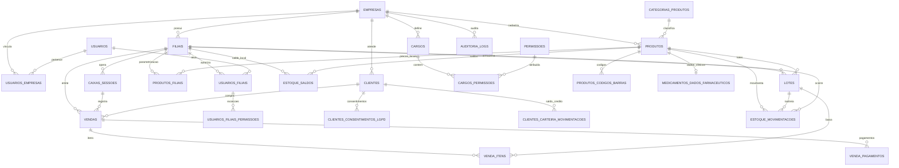

# FarmaPro — Modelo de Dados, Arquitetura PostgreSQL e Isolamento Multiempresa

## 1. Visão Geral da Arquitetura de Dados

O FarmaPro foi modelado para atender aos rigorosos requisitos de um SaaS farmacêutico brasileiro:
* **Multi-tenancy com Isolamento RLS:** Garantia matemática e estrutural de que uma farmácia jamais acesse dados de outra farmácia no mesmo banco de dados.
* **Desacoplamento de Produtos e Medicamentos:** Medicamentos possuem dados regulatórios e clínicos específicos (ANVISA, DCI, Portaria 344/SNGPC), enquanto itens de perfumaria, cosméticos e conveniência possuem estruturas simplificadas.
* **Controle Rigoroso de Lotes e Validades (FEFO):** Rastreabilidade unitária por filial, impedindo a comercialização de produtos vencidos, bloqueados ou em quarentena.
* **Integridade Financeira em Centavos:** Todos os valores monetários são tipados como `BIGINT` representando centavos inteiros (BRL), prevenindo erros de arredondamento.
* **Auditoria Imutável e Offline-First:** Toda movimentação de estoque e caixa é auditada em ledger imutável, e as operações de PDV possuem identificadores únicos para suportar contingência offline sem duplicidade de vendas.

---

## 2. Diagrama Entidade-Relacionamento (ERD)



---

## 3. Dicionário de Dados & Estrutura das Tabelas

### 3.1. Núcleo Multiempresa & Controle de Acesso (RBAC)

1. **`empresas`**: Tenant principal (Razão Social, CNPJ, Plano, Status).
2. **`filiais`**: Unidades físicas de cada empresa (Código filial, CNPJ, Endereço, Flag matriz).
3. **`usuarios`**: Cadastro unificado de pessoas/operadores (Nome, CPF, Email, Hash senha, CRF e UF caso farmacêutico).
4. **`usuarios_empresas`**: Vínculo do usuário com o tenant (Papel principal: PROPRIETARIO, ADMINISTRADOR, COLABORADOR).
5. **`cargos`**: Perfis de função por empresa (Ex: Farmacêutico RT, Gerente, Operador de Caixa).
6. **`permissoes`**: Catálogo imutável de permissões atômicas do sistema FarmaPro (`pdv:vender`, `estoque:ajustar`, `medicamentos:controlados`, etc.).
7. **`cargos_permissoes`**: Mapeamento N:N entre cargos e permissões padrão.
8. **`usuarios_filiais`**: Vínculo e autorização expressa do usuário em filiais específicas da empresa.
9. **`usuarios_filiais_permissoes`**: Exceções por filial (permissões adicionais concedidas ou revogadas pontualmente).
10. **`dispositivos_autorizados`**: Terminais de PDV e computadores de balcão autorizados com identificador de hardware (UUID).

### 3.2. Catálogo Desacoplado de Produtos & Medicamentos

1. **`categorias_produtos`**: Hierarquia mercadológica (Medicamentos Referência, Genéricos, Similares, MIPs, Higiene, Perfumaria, etc.).
2. **`produtos`**: Cadastro central do produto (Nome comercial, Fabricante, Unidade de medida, Tipo de produto).
3. **`produtos_codigos_barras`**: Suporte a múltiplos códigos de barra (EAN-13, EAN-14, código interno de fracionamento).
4. **`medicamentos_dados_farmaceuticos`**: Tabela 1:0..1 vinculada exclusivamente a medicamentos:
   * `principio_ativo_dci`: Denominação Comum Brasileira / Internacional.
   * `concentracao`: Ex: "500 mg".
   * `forma_farmaceutica`: Comprimido, Pomada, Solução oral, Injetável.
   * `via_administracao`: Oral, Tópica, Oftálmica, etc.
   * `registro_anvisa`: Número oficial de registro sanitário.
   * `classificacao_receita`: ISENTO (MIP), RECEITA_BRANCA_SIMPLES, RECEITA_BRANCA_ESPECIAL, RECEITA_AZUL, RECEITA_AMARELA.
   * `lista_controlado_portaria344`: A1, A2, B1, B2, C1, C2...
   * `termossensivel`: Booleano para medicamentos que exigem cadeia de frio (ex: 2°C a 8°C).
5. **`produtos_filiais`**: Configurações comerciais e de estoque parametrizadas por filial (Preço de venda local, Preço promocional, Estoque mínimo local, Localização na prateleira).

### 3.3. Rastreabilidade de Lotes e Validades (FEFO)

1. **`lotes`**:
   * `empresa_id`, `filial_id`, `produto_id`.
   * `numero_lote`: Identificação do lote do fabricante.
   * `data_fabricacao`, `data_validade`.
   * `quantidade_recebida`, `quantidade_disponivel`, `quantidade_reservada`, `quantidade_bloqueada`.
   * `status`: `ATIVO`, `QUARENTENA`, `BLOQUEADO`, `VENCIDO`, `ESGOTADO`.
   * `motivo_bloqueio`: Descrição textual de eventuais interdições cautelares da ANVISA ou avarias.
   * `origem_tipo`: `COMPRA_NFE`, `AJUSTE_INVENTARIO`, `TRANSFERENCIA_FILIAL`.

### 3.4. Clientes & Proteção de Dados (LGPD)

1. **`clientes`**:
   * Identificação (Nome, CPF/CNPJ, RG, Data de nascimento, Telefone, WhatsApp, Email, Endereço).
   * Crediário ("Caderno digital"): Limite de crediário em centavos, Saldo devedor em centavos, Bloqueio para crediário.
   * Carteira de Troco / Créditos: Saldo em centavos decorrente de troco ou devoluções.
2. **`clientes_consentimentos_lgpd`**: Registro explícito de autorizações do cliente (comunicação de promoções, retenção de histórico de receitas para lembretes de tratamento).
3. **`clientes_carteira_movimentacoes`**: Extrato auditável de créditos e débitos da carteira de troco do cliente.

### 3.5. Frente de Caixa (PDV), Vendas e Pagamentos

1. **`caixas_sessoes`**: Sessão de caixa aberta pelo operador (Terminal, Saldo inicial, Total suprimentos, Total sangrias, Data/hora abertura e fechamento).
2. **`vendas`**:
   * `numero_cupom_sequencial`, `serie_terminal`.
   * `subtotal_centavos`, `desconto_centavos`, `acrescimo_centavos`, `total_centavos`, `troco_centavos`.
   * `status`: `ABERTA`, `CONCLUIDA`, `CANCELADA`, `ESTORNADA`.
   * Campos de resiliência offline: `id_offline_uuid`, `chave_idempotencia`, `sincronizado_em`, `hash_integridade`.
3. **`venda_itens`**: Itens vendidos, lote vinculado (para rastreabilidade), quantidade, preço unitário em centavos, desconto e total.
4. **`venda_pagamentos`**: Formas de pagamento utilizadas (Dinheiro, PIX, Cartão de Crédito, Cartão de Débito, Crediário, Carteira de Crédito). Suporta divisão em múltiplos métodos.

### 3.6. Estoque & Movimentações (Ledger Imutável)

1. **`estoque_saldos`**: Tabela de consulta rápida de saldo físico, reservado e disponível por produto e filial.
2. **`estoque_movimentacoes`**: Livro-razão imutável (*append-only ledger*) registrando cada entrada, saída por venda, reserva de PDV, cancelamento, perda por vencimento ou transferência.
3. **`estoque_reservas`**: Bloqueios temporários de quantidade enquanto uma venda está com carrinho aberto no PDV, evitando concorrência destrutiva entre caixas.

### 3.7. Auditoria Geral e Resolução de Conflitos Offline

1. **`auditoria_logs`**: Trilha imutável de eventos críticos (Aberturas de caixa, Descontos superiores à alçada, Cancelamentos de itens, Ajustes de estoque), contendo snapshots `JSONB` antes e depois.
2. **`sincronizacao_offline_conflitos`**: Fila de auditoria para transações que sofreram reconciliação pós-queda de internet (ex: divergência de saldo que exigiu reajuste automático).

---

## 4. Estratégia de Isolamento Multiempresa por RLS (Row-Level Security)

### 4.1. Como Funciona a Proteção Nativa
Em cada tabela com dados de empresa, habilitamos `ROW LEVEL SECURITY` e forçamos a aplicação das regras:
```sql
ALTER TABLE [nome_tabela] ENABLE ROW LEVEL SECURITY;
ALTER TABLE [nome_tabela] FORCE ROW LEVEL SECURITY;
```

A segregação baseia-se em variáveis de sessão da conexão:
* `app.current_empresa_id`: UUID da empresa autenticada.
* `app.current_filial_id`: UUID da filial operacional da sessão.
* `app.current_usuario_id`: UUID do operador autenticado.

### 4.2. Injeção Transacional via `SET LOCAL`
O backend (Fastify) injeta essas variáveis em transações protegidas:
```sql
BEGIN;
  SET LOCAL app.current_empresa_id = 'c1a8d052-7b83-4f9e-9d8a-3e2849c95111';
  SET LOCAL app.current_filial_id  = 'f2b9e163-8c94-4a0f-ae9b-4f3950d06222';
  SET LOCAL app.current_usuario_id = 'u3c0f274-9da5-4b10-bf0c-5a4061e17333';
  
  -- Toda query aqui dentro é filtrada automaticamente pelo PostgreSQL
  SELECT * FROM produtos;
COMMIT;
```
Se a conexão for devolvida ao pool, o `SET LOCAL` é automaticamente descartado ao fim da transação, prevenindo qualquer vazamento de contexto entre tenants concorrentes.

---

## 5. Estratégia de Resiliência Offline-First

1. **Identificadores Gerados no Terminal (UUIDv4):** Toda venda gerada no PDV em modo offline recebe um `id_offline_uuid` imutável.
2. **Chave de Idempotência:** A sincronização para a nuvem envia a venda com `chave_idempotencia = SHA256(empresa_id + filial_id + terminal_id + numero_sequencial + id_offline_uuid)`. O banco rejeita duplicidades via constraint única `UNIQUE(chave_idempotencia)`.
3. **Controle de Concorrência e Estoque Local:**
   * O terminal offline opera com cópia local em SQLite contendo catálogo, preços e lotes.
   * Vendas offline geram baixa local imediata.
   * Ao sincronizar com o servidor central, as movimentações de estoque entram com a data/hora original do terminal e atualizam o ledger central em ordem de ocorrência auditada.
