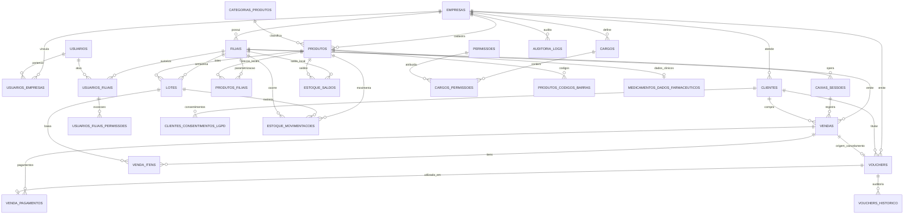

# FarmaPro — Modelo de Dados, Arquitetura PostgreSQL e Isolamento Multiempresa

## 1. Visão Geral da Arquitetura de Dados

O FarmaPro foi modelado para atender aos rigorosos requisitos de um SaaS farmacêutico brasileiro:
* **Multi-tenancy com Isolamento RLS:** Garantia matemática e estrutural de que uma farmácia jamais acesse dados de outra farmácia no mesmo banco de dados.
* **Desacoplamento de Produtos e Medicamentos:** Medicamentos possuem dados regulatórios e clínicos específicos (ANVISA, DCI, Portaria 344/SNGPC), enquanto itens de perfumaria, cosméticos e conveniência possuem estruturas simplificadas.
* **Controle Rigoroso de Lotes e Validades (FEFO):** Rastreabilidade unitária por filial, impedindo a comercialização de produtos vencidos, bloqueados ou em quarentena.
* **Operações de Estoque Independentes de Cargo:** As atividades de estoque (consulta, entrada, movimentação, ajustes, inventários e lotes) são controladas por permissões granulares configuráveis pelo proprietário, sem dependência do cargo "Estoquista".
* **Ausência de Crédito Próprio da Farmácia:** O FarmaPro não possui crediário próprio, limite de crédito, carteira de clientes ou dívidas internas. Pagamentos externos comerciais (Cartão de Crédito/Débito parcelado, PIX e Dinheiro) continuam normalmente.
* **Vouchers Auditáveis com Resgate Integral:** Vouchers originados exclusivamente do cancelamento/devolução autorizada de uma venda anterior, com exigência de **resgate 100% integral em uma única compra**, sem troco e sem resíduos.
* **Integridade Financeira em Centavos:** Todos os valores monetários são tipados como `BIGINT` representando centavos inteiros (BRL), prevenindo erros de arredondamento.

---

## 2. Diagrama Entidade-Relacionamento (ERD)

---

## 3. Dicionário de Dados & Estrutura das Tabelas

### 3.1. Núcleo Multiempresa & Controle de Acesso (RBAC)
1. **`empresas`**: Tenant principal (Razão Social, CNPJ, Plano, Status).
2. **`filiais`**: Unidades físicas de cada empresa (Código filial, CNPJ, Endereço, Flag matriz).
3. **`usuarios`**: Cadastro unificado de operadores (Nome, CPF, Email, Hash senha, CRF e UF caso farmacêutico).
4. **`usuarios_empresas`**: Vínculo do usuário com o tenant (`PROPRIETARIO`, `ADMINISTRADOR`, `COLABORADOR`).
5. **`cargos`**: Perfis funcionais independentes por empresa (Ex: Farmacêutico RT, Gerente, Operador de Caixa). Não há cargo Estoquista pré-fixado.
6. **`permissoes`**: Catálogo de permissões atômicas (`pdv:vender`, `vouchers:emitir`, `estoque:visualizar`, `estoque:ajustar`, `estoque:inventario`, etc.).
7. **`cargos_permissoes`**: Mapeamento N:N entre cargos e permissões padrão.
8. **`usuarios_filiais`**: Autorização expressa do funcionário em filiais específicas.
9. **`usuarios_filiais_permissoes`**: Exceções por filial (concessões adicionais ou revogações).
10. **`dispositivos_autorizados`**: Terminais de PDV autorizados com identificador de hardware (UUID).

### 3.2. Catálogo Desacoplado de Produtos & Medicamentos
1. **`categorias_produtos`**: Hierarquia mercadológica.
2. **`produtos`**: Cadastro central do item (`nome_comercial`, `fabricante`, `apresentacao`, `unidade_medida`, `tipo_produto`).
3. **`produtos_codigos_barras`**: Múltiplos códigos por produto (EAN-13, EAN-14, DUN-14, código interno).
4. **`medicamentos_dados_farmaceuticos`** (1:0..1 com `produtos`): Atributos clínicos exclusivos de medicamentos (Princípio ativo DCI, Registro ANVISA, Classificação de receita, Portaria 344/SNGPC, Termossensível).
5. **`produtos_filiais`**: Parametrização comercial por unidade (`preco_custo_centavos`, `preco_venda_centavos`, `estoque_minimo`, `ativo`).

### 3.3. Rastreabilidade de Lotes e Validades (FEFO)
1. **`lotes`**: `numero_lote`, `data_fabricacao`, `data_validade`, `quantidade_recebida`, `quantidade_disponivel`, `quantidade_reservada`, `quantidade_bloqueada`, `status: ATIVO, QUARENTENA, BLOQUEADO, VENCIDO, ESGOTADO`.

### 3.4. Clientes & Proteção de Dados (LGPD)
1. **`clientes`**: Dados cadastrais por empresa (Nome, CPF/CNPJ, Telefone, Email, Endereço). **Sem limites de crédito, sem saldo devedor e sem carteira de crédito**.
2. **`clientes_consentimentos_lgpd`**: Registro explícito de autorizações do cliente (Marketing, Lembrete de tratamento contínuo, Retenção de histórico).

### 3.5. Vouchers (Origem em Cancelamentos & Regra de Resgate Integral)
1. **`vouchers`**:
   * `empresa_id`, `filial_origem_id`, `codigo_voucher UNIQUE`.
   * `valor_centavos`: Valor integral gerado no cancelamento.
   * `venda_origem_id`: Venda cancelada que originou o voucher.
   * `motivo_cancelamento_origem`: Justificativa legal/comercial.
   * `status`: `DISPONIVEL`, `UTILIZADO`, `CANCELADO`, `EXPIRADO`.
   * Rastreabilidade: `emitido_por_id`, `autorizado_por_id`, `utilizado_em`, `utilizado_por_id`, `venda_resgate_id`.
2. **`vouchers_historico`**: Trilha de auditoria das movimentações do voucher (`EMISSAO`, `CONSULTA_VALIDACAO`, `RESGATE_UTILIZACAO`, `CANCELAMENTO_VOUCHER`, `ESTORNO_VENDA_RESGATE`).

**Regras Mandatórias do Voucher:**
* Resgate 100% integral em uma única compra.
* Se Compra < Voucher: Bloquear resgate (não há devolução de troco nem resíduos).
* Se Compra > Voucher: Voucher cobre 100% do seu valor e a diferença é paga por modalidade aceita (Dinheiro, Cartão, PIX).
* O voucher **não** é dinheiro líquido recebido no caixa físico, tratando-se de quitação de obrigação decorrente de cancelamento.

### 3.6. Frente de Caixa (PDV), Vendas e Pagamentos
1. **`caixas_sessoes`**: Abertura, suprimentos, sangrias e fechamento cego por operador.
2. **`vendas`**: Vendas do PDV com suporte a contingência offline (`id_offline_uuid`, `chave_idempotencia`, `hash_integridade`).
3. **`venda_itens`**: Itens com rastreio de lote e retenção de receita.
4. **`venda_pagamentos`**: Modalidades de pagamento: `DINHEIRO`, `CARTAO_CREDITO`, `CARTAO_DEBITO`, `PIX`, `VOUCHER`, `CONVENIO_EMPRESA`.

### 3.7. Estoque, Auditoria e Conflitos
1. **`estoque_saldos`**: Consulta rápida de saldos físicos, reservados e disponíveis.
2. **`estoque_reservas`**: Bloqueios temporários para evitar concorrência de caixas simultâneos.
3. **`estoque_movimentacoes`**: Livro-razão contábil imutável (*append-only ledger*).
4. **`auditoria_logs`**: Trilha de auditoria com snapshots em `JSONB`.
5. **`sincronizacao_offline_conflitos`**: Fila de conciliação para operações sincronizadas.

---

## 4. Políticas de Row-Level Security (RLS)
Todas as 23 tabelas com dados de empresas possuem RLS ativado e forçado (`FORCE ROW LEVEL SECURITY`), filtradas pela variável de sessão `app.current_empresa_id`.
Os vouchers pertencem estritamente à empresa emissora: um usuário da Empresa A jamais conseguirá validar ou resgatar vouchers emitidos pela Empresa B.
